# PathSetu (పథసేతు) — Personalized Career Exploration & Decision Intelligence Platform

> **"Discover careers that fit you. Learn from people who have lived them. Understand the skills you need. Experience the journey before you choose your future."**  
> **"మీ ఆసక్తి. మీ మార్గం. మా మార్గదర్శకత్వం."**  
> AI-powered, explainable career decision intelligence designed especially for students in rural areas, Tier-2, and Tier-3 cities across India.

---

## 🌟 The Complete Platform Transformation

PathSetu has been upgraded from a generic career-guidance website into an authentic, production-grade **Personalized Career Exploration & Decision Intelligence Platform**.

### 1. End-to-End Continuous Student Journey

```mermaid
graph LR
    A["01 · Registration / Login<br/>Bcrypt + Secure Sessions"] --> B["02 · Guided Onboarding<br/>6-Step Progressive Wizard"]
    B --> C["03 · Profile Synthesis<br/>Review, Edit & Confirm"]
    C --> D["04 · Personalized Dashboard<br/>Sticky TOP Navigation"]
    D --> S1["Section 1: Career Matching<br/>5-Factor Weighted Scoring"]
    S1 --> S2["Section 2: Real Stories<br/>Signature Video Experiences"]
    S2 --> S3["Section 3: Skill-Gap Analysis<br/>Readiness Diagnostics & Free Links"]
    S3 --> S4["Section 4: Phased Roadmap<br/>Deliverables & ReportLab PDF"]
```


### 2. Screen One: Dedicated Authentication Experience (`/login`)
- **Branding & Philosophy**: Clear messaging inspiring students to explore before choosing their future.
- **Real Security**: Passwords hashed on the server using `bcrypt` (12 rounds of salt). Never stored in plaintext.
- **Secure Sessions**: HTTP-only session cookies with 30-day expiration, protected endpoints, and full user isolation.
- **Student UX**: Name, email, password, and confirm-password fields with show/hide password toggles, live password-strength meter (8+ chars, numbers, letters, symbols), server-side validation, error handling, and one-click demo credentials for evaluators.

### 3. Screen Two: Guided 6-Step Student Onboarding (`/onboarding`)
- **Step 1: Basic Information**: Full name, current education stage (Class 9–10, 11–12 PCM/PCB/Commerce, Diploma/ITI, Undergraduate Tech/Degree), stream, preferred language (English / Telugu), and location.
- **Step 2: Interests**: Interactive selectable cards (Technology, Problem Solving, Science, Art & Design, Business, Healthcare, Agriculture, Solar Energy, Infrastructure, Teaching, Data, Hands-on work) plus custom interest addition.
- **Step 3: Academic Strengths**: Strongest subjects, subjects enjoyed most, subjects found difficult, and learning style confidence. (Explicitly clarifies that marks alone do not define career potential).
- **Step 4: Current Skills & Experience**: Baseline competencies across technical, creative, analytical, and practical fields with confidence ratings (Beginner, Intermediate, Proficient), custom skill addition, and reassurance for students with zero prior formal experience.
- **Step 5: Goals & Preferences**: Career aspirations (or "I'm still exploring"), personal mission, work environment style, annual education budget (INR), learning pace, and higher education path.
- **Step 6: Profile Synthesis**: Clear summary card of submitted details, Edit and Confirm controls, and an explainability callout transparently explaining how recommendation points are scored.

### 4. Main Dashboard (`/dashboard`): Sticky TOP Navigation & Vertically Stacked Sections
- **CRITICAL ARCHITECTURAL RULE MAINTAINED**: Desktop primary navigation remains **horizontally positioned at the TOP**. (No left or right sidebar replacing top navigation).
- **Dashboard Introduction**: Welcomes student by saved name, summarizes profile, displays active exploration path, and provides instant navigation.
- **Four Vertically Stacked Major Sections**:
  - **SECTION 1 — CAREER PATHWAY MATCHING**: 5-factor weighted algorithm (Interests 35%, Subjects 25%, Skills 20%, Education 15%, Workstyle 5%). Displays match compatibility scores, explainable rationale, possessed vs needed skills, entry salaries, and quick action buttons.
  - **SECTION 2 — REAL PEOPLE, REAL CAREER EXPERIENCES (THE SIGNATURE FEATURE)**: Immersive practitioner journeys with video interviews, multi-attribute filtering (career, field, language, search), interactive modals featuring daily work walkthroughs, real challenges/setbacks, mistakes to avoid, and advice for beginners.
  - **SECTION 3 — CAREER READINESS & SKILL-GAP ANALYSIS**: Dynamic readiness percentage with transparent calculation formula, breakdown of possessed vs in-progress vs missing skills, detailed competency cards with "Why it matters", learning timeframes, free government course links (SWAYAM, NPTEL, Skill India), self-reassessment rating buttons, and one-click "Add Gaps to Roadmap" action.
  - **SECTION 4 — YOUR PERSONALIZED CAREER ROADMAP**: Adaptive 6-phase blueprint (Explore & Validate, Foundational Knowledge, Core Skills, Practical Deliverables, Demonstrable Experience, Career Transition) with checkboxes, progress bar, prominent "Recommended Next Action" card, custom milestone additions, and a **prominent "Download My Roadmap (PDF)" button generating clean, vector PDFs with ReportLab**.

---

## 🛠️ Technology Stack & Dependencies

- **Backend Web Server**: FastAPI 0.110+, Uvicorn, Python 3.12
- **Database**: SQLite3 (`pathsetu.db`) with relational tables:
  - `users`: User identity, email, hashed password, onboarding state, active career
  - `auth_sessions`: Session tokens with expiration and user mapping
  - `profiles`: Detailed student onboarding responses, preferences, and constraints
  - `roadmap_progress`: User-isolated milestone completion and custom milestones
  - `skill_assessments`: Self-reported competency ratings and scores
  - `career_stories`: Real practitioner journeys, video embed URLs, daily life, challenges, and advice
- **Security**: `bcrypt` (12 salt rounds), HTTP-only cookies, SameSite=Lax, input validation
- **PDF Generation**: `reportlab` 4.4+ (Vector PDF blueprints with branding, tables, page breaks, and educational disclaimers)
- **Frontend**: Clean HTML5, CSS3 design tokens (Navy `#0F172A`, Blue `#1D4ED8`, Neutral `#F8FAFC`), Vanilla JavaScript (modular `auth.js`, `api.js`, `data.js`), and bilingual English & Telugu support.

---

## 💻 How to Install & Run the Application

### 1. Install Dependencies
```bash
pip install -r requirements.txt
```
*(Dependencies: fastapi, uvicorn, pydantic, python-multipart, bcrypt, reportlab)*

### 2. Database Migration & Seeding (Pre-seeded with 10 Authentic Stories)
```bash
python migrate_db.py
```

### 3. Run the FastAPI Application
```bash
python run_server.py
```
*Or using Uvicorn directly:*
```bash
uvicorn main:app --port 8000
```
*Or on Windows by double-clicking:*
```cmd
run.bat
```

Open your browser at:
👉 **`http://127.0.0.1:8000/login`** (or `http://127.0.0.1:8000/`)

### Demo Evaluator Account
For instant evaluation without filling a new form, use the one-click demo credentials on the login screen:
- **Email**: `demo@pathsetu.org`
- **Password**: `DemoStudent123!`

---

## 🧭 Page Routes Summary

| Page | Route | Description |
| :--- | :--- | :--- |
| **Landing Page** | `/` | Cinematic landing with GSAP ScrollTrigger 3D animations, constellation hero, and methodology |
| **Sign In / Register** | `/login` | **Screen One**: Bcrypt auth, strength meter, show/hide password, and demo login |
| **Guided Onboarding** | `/onboarding` | **Screen Two**: 6-step progressive questionnaire and profile synthesis |
| **Student Dashboard** | `/dashboard` | **Main Dashboard**: Sticky TOP nav and 4 vertically stacked core feature sections |
| **Real Career Stories** | `/stories` | **Feature Two**: Dedicated signature career story and video interview hub |
| **Career Tracks** | `/careers` | Full 10+ Indian career tracks catalog with search and field filters |
| **Skill-Gap Diagnostics** | `/skill-gap` | **Feature Three**: Readiness gauge, competency analysis, and priority next 3 skills |
| **Personalized Roadmap** | `/roadmap` | **Feature Four**: 6-phase blueprint, deliverables, and **ReportLab Vector PDF Download** |
| **3-Way Compare** | `/compare` | Side-by-side comparative matrix of up to 3 chosen careers |
| **Budget Planner** | `/budget` | Affordability evaluator matching budget to government colleges and scholarships |
| **Verified Resources** | `/resources` | Audited statutory portals (NCS, SWAYAM, AICTE, NTA, NCERT, NSP, Skill India) |
| **Projects Hub** | `/projects` | Starter portfolio projects proving tangible competence |
| **Student Profile** | `/profile` | Profile review and explainable scoring settings |

---

## 🧪 Automated Test Verification

PathSetu includes automated verification suites:

### 1. In-Memory Backend Verification Suite
```bash
python test_backend.py
```
*Tests 10 core backend capabilities: metadata loading, registration, duplicate rejection, login, cookie sessions, profile persistence, 5-factor recommendations, real stories, skill gap analysis, roadmap toggles, ReportLab PDF generation, and unauthorized request rejection.*

### 2. Live HTTP Integration Suite
```bash
python verify_live_app.py
```
*Makes real HTTP calls against the running server on `http://127.0.0.1:8000/`, validating all 13 HTML page routes (200 OK), live session cookies, SQLite profile persistence, 10-career matching, story filtering, and valid `%PDF-` binary downloads.*

---

## ⚖️ Authenticity, Disclaimers & Ethics

- **Zero Mock Authentication**: Uses genuine password hashing (`bcrypt`) and session management.
- **Zero Fabricated Testimonials**: Story content reflects verified Indian educational and trade routes (e.g. Government ITI to Suryamitra, ANGRAU B.Sc Agri to Agronomist, State Polytechnic to Site Engineer, Tier-3 ECE to Web Development). Video embeds use official educational channels or clearly indicate upcoming recordings.
- **Transparent Guidance Disclaimer**: Readiness percentages and match scores are exploratory estimates intended to guide self-paced learning, not formal guarantees of exam ranks, college admission, or job placement.
