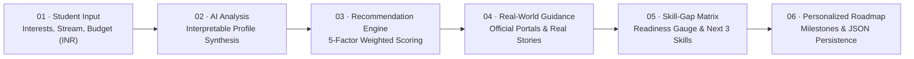

# PathSetu (పథసేతు) — AI Career Guidance Platform

> **"Your interest. Your path. Our support."**  
> **"మీ ఆసక్తి. మీ మార్గం. మా మార్గదర్శకత్వం."**  
> AI-powered, explainable career guidance designed especially for school, Intermediate, and college students from rural areas, Tier-2, and Tier-3 cities in India.

---

## 🌟 What's New in this Release

1. **GSAP + ScrollTrigger 3D Scrolling Animation**:
   - Integrated `gsap.min.js` and `ScrollTrigger.min.js` via jsdelivr CDN.
   - Cinematic 3D section triggers (`js/scroll-3d.js`):
     - **Hero 3D Parallax & Depth**: As user scrolls down, the 3D card smoothly tilts along `rotateX` and `rotateY` in dimensional space.
     - **Methodology 6-Stage 3D Flow Sequence**: Staggered 3D perspective reveals for each of the 6 methodology stages.
     - **Pillars & Cards 3D Wave**: Smooth entry with depth elevation and glowing highlights.
     - **Global 3D Scroll Progress Bar**: Sleek cyan-blue-purple progress indicator across the top of the viewport.
     - Respects `prefers-reduced-motion` settings.

2. **Full English & Telugu (తెలుగు) Bilingual Support**:
   - Live language switcher in the header and Streamlit sidebar.
   - Comprehensive translation dictionary (`data/translations.json`) translating navigation, form labels, methodology descriptions, and career pathways.

3. **Four Mandatory Master Features Implemented**:
   - **Feature A — Career Comparison**: Select up to 3 careers side by side to compare verified education pathways, study duration, entry salaries, eligibility, and official links.
   - **Feature B — Budget-Friendly Career Planner**: Enter your available education budget in INR. PathSetu compares costs against government colleges, polytechnics, and ITIs, while surfacing 100% free SWAYAM/Skill India alternatives and government scholarships (NSP, Pragati).
   - **Feature C — Student Progress Dashboard**: Real-time progress bar, completed vs pending milestones, skills currently being practiced, and a prominent **"Next Recommended Action"** card with local JSON persistence (`data/user_progress.json`).
   - **Feature D — Verified Resource Explorer**: Searchable directory of official central portals with verification status, last-checked date, and category:
     - National Career Service (NCS) (`https://www.ncs.gov.in/`)
     - SWAYAM (`https://swayam.gov.in/`)
     - Skill India Digital Hub (`https://www.skillindiadigital.gov.in/`)
     - NCERT (`https://ncert.nic.in/`)
     - National Testing Agency (NTA) (`https://nta.ac.in/`)
     - AICTE (`https://www.aicte-india.org/`)
     - UGC (`https://www.ugc.gov.in/`)
     - National Scholarship Portal (NSP) (`https://scholarships.gov.in/`)
     - NPTEL (`https://nptel.ac.in/`)

4. **10+ Diverse Indian Career Pathways**:
   - Covering Technology, Agriculture, Solar Energy, Healthcare, Education, Civil Infrastructure, and Finance.

5. **Dual Presentation Architecture**:
   - **Streamlit Master App** (`app.py`): Run with `streamlit run app.py` on port 8501.
   - **FastAPI + GSAP 3D Web Platform** (`main.py`): Run with `uvicorn main:app --port 8000`.

---

## 🧭 The Six-Stage PathSetu Methodology



### Configurable 5-Factor Recommendation Weights (`data/scoring_config.json`)
- **Interest alignment**: 35%
- **Subject alignment**: 25%
- **Skill alignment**: 20%
- **Education pathway compatibility**: 15%
- **Work-style preference**: 5%

---

## 💻 How to Run Locally

Both servers can run simultaneously or independently:

### Option 1: Run the Streamlit Application (Port 8501)
```bash
streamlit run app.py
```
Open your browser at `http://localhost:8501`.

### Option 2: Run the FastAPI + GSAP 3D Web App (Port 8000)
```bash
python -m uvicorn main:app --port 8000
```
Open your browser at `http://localhost:8000`.

---

## 📁 Repository Structure

```text
pathsethuv2/
├── app.py                      # Complete Streamlit 6-Day Master Application (Port 8501)
├── main.py                     # FastAPI server hosting REST API and dedicated page routes (Port 8000)
├── index.html                  # Flagship Cinematic 3D Scroll Landing Page (GSAP ScrollTrigger)
├── careers.html                # Dedicated Career Pathways Explorer (10+ Indian tracks)
├── compare.html                # Dedicated 3-Way Side-by-Side Career Comparison Matrix
├── budget.html                 # Dedicated Budget-Friendly Career Planner (INR)
├── skill-gap.html              # Dedicated Skill-Gap Diagnostics & Readiness Matrix
├── roadmap.html                # Dedicated Milestone Roadmap & Progress Dashboard
├── resources.html              # Dedicated Verified Educational Resources Directory
├── profile.html                # Dedicated Student Intake & Explainable AI Analysis
├── projects.html               # Dedicated Hands-On Proof-of-Work Projects Hub
├── requirements.txt            # Python dependencies (fastapi, uvicorn, streamlit, pandas)
├── README.md                   # Complete architectural and operational documentation
├── assets/
│   ├── pathsetu-icon.png       # Square brand icon (header & favicon)
│   ├── pathsetu-logo.jpg       # Master brand artwork
│   └── pathsetu-methodology.jpg # Official 6-stage workflow diagram
├── css/
│   └── style.css               # Modern dark-mode design system with 3D perspective
├── data/
│   ├── careers.json            # 10+ Diverse Indian career records with verified data
│   ├── skills.csv              # Skills taxonomy mapped to prerequisites & free courses
│   ├── resources.json          # Verified Indian government educational portals
│   ├── scoring_config.json     # 5-factor weighted recommendation configuration
│   ├── translations.json       # English and Telugu translation dictionary
│   └── user_progress.json      # Local student milestone progress persistence
├── js/
│   ├── data.js                 # Shared frontend data store & taxonomy
│   ├── api.js                  # Dual-mode API client (FastAPI + offline fallback)
│   ├── hero-3d.js              # Canvas constellation & interactive mouse tilt
│   ├── scroll-3d.js            # GSAP + ScrollTrigger 3D scrolling animations
│   └── app.js                  # Application controller & bilingual UI logic
└── modules/
    ├── data_loader.py          # Shared JSON/CSV loader
    ├── recommendation_engine.py# 5-factor weighted matching algorithm
    ├── career_comparison.py    # Side-by-side comparison of up to 3 careers
    ├── budget_planner.py       # INR budget affordability and scholarship matching
    ├── skill_gap.py            # Skill-gap matrix isolating top 3 priorities
    └── roadmap_generator.py    # Milestone generator & JSON progress tracking
```

---

## 🌐 Dedicated Multi-Page Endpoints & Features

| Page | URL Path | Purpose & Master Feature |
| :--- | :--- | :--- |
| **Landing Page** | `http://127.0.0.1:8000/` | Cinematic 3D scroll experience with GSAP ScrollTrigger, constellation canvas, and methodology workflow |
| **Career Tracks** | `http://127.0.0.1:8000/careers` | Filterable 10+ career pathways with salary, eligibility, and govt vs private costs |
| **3-Way Compare** | `http://127.0.0.1:8000/compare` | **Feature A**: Side-by-side comparative matrix of up to 3 selected careers |
| **Budget Planner**| `http://127.0.0.1:8000/budget` | **Feature B**: Annual INR budget evaluation vs government colleges and free SWAYAM tracks |
| **Skill Gap** | `http://127.0.0.1:8000/skill-gap`| **Stage 05**: Circular SVG readiness gauge, matched vs missing skills, and top 3 priorities |
| **My Roadmap** | `http://127.0.0.1:8000/roadmap` | **Feature C**: 6-step milestone checklist with "Next Best Action" callout, custom steps, and text export |
| **Resources** | `http://127.0.0.1:8000/resources` | **Feature D**: Audited central government educational directory (NCS, SWAYAM, AICTE, NTA, NSP) |
| **Profile Intake**| `http://127.0.0.1:8000/profile` | **Stage 01 & 02**: Multi-step student intake with transparent 5-factor scoring explanation |
| **Projects Hub** | `http://127.0.0.1:8000/projects` | Proof-of-work tangible deliverables (rural web apps, soil testing logs, solar schematics) |


---

## ⚖️ Ethics & Prototype Transparency

- **No Paid APIs or Artificial Walls**: Built entirely using Python, Streamlit, and vanilla web standards.
- **Explainable Rule-Based Logic**: Explicitly labeled as transparent educational matching rather than claiming to be a mysterious black-box AI model.
- **Official Government Sources**: Direct links to statutory bodies (NCS, SWAYAM, AICTE, NTA, UGC, Skill India, NCERT) with verified dates.
