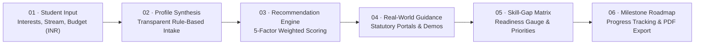

# PathSetu (పథసేతు) — A Bridge to Your Career Future

> **"Your interest. Your path. Our support."**  
> **"మీ ఆసక్తి. మీ మార్గం. మా మార్గదర్శకత్వం."**  
> An explainable, data-driven, and affordable career guidance platform tailored for Indian students after Class 10, Intermediate, and College—with a special focus on rural, Tier-2, and Tier-3 communities in both **English and Telugu (తెలుగు)**.

Deployment: Ready for **Netlify**, **Render**, **GitHub Pages**, and **Cloudflare Pages** (Configuration included).

---

## 🌟 What's New in this Major Full-Stack Release (v2.0)

1. **Modern React 18 + TypeScript + Vite SPA Architecture**:
   - Replaced fragmented static HTML pages with a high-performance, responsive React single-page application.
   - Componentized design system using **Tailwind CSS**, **Lucide icons**, and **Leaflet OpenStreetMap**.
   - Strict TypeScript safety with zero build warnings.

2. **Full PathSetu Brand Identity**:
   - **Soft off-white background**: `#F5F7F2`
   - **Forest green primary**: `#234B3D`
   - **Sage green secondary**: `#B9C9B3`
   - **White surfaces** with restrained neutral borders (`#DDE5DA`) and dark typography (`#162820`).
   - Clean, high-trust aesthetic directly mirroring the 5 reference design patterns.

3. **Complete Implementation of the 5 Reference UX Patterns**:
   - **Reference 1 — Guided Assessment (`/assessment`)**: Step indicator progress bar, prominent question statement, Likert scale options (*Strongly Disagree* to *Strongly Agree*), Previous/Next controls, and the *"Why assessment matters"* guidance card.
   - **Reference 2 & 4 — Student Dashboard (`/dashboard`)**: Career milestone progress bar, weekly learning time tracker, 7-day study streak flame badges, learning strands cards, and mastery summary diagnostics table.
   - **Reference 3 — 3-Way Education & Career Comparison (`/compare`)**: Side-by-side comparison matrix with semi-circular cost gauge, 4-year stacked tuition/fee breakdowns, and recommended statutory scholarships.
   - **Reference 5 — Career Details & Skill-Gap Matrix (`/careers/:careerId`)**: Role Summary, Key Responsibilities checkmarks, Ideal Candidate DNA card (*Mindset, Vibe, Standard*), Actionable Nudges, and interactive skill badges that update readiness scores dynamically.

4. **New Feature A — Real-Time Student Reviews & Interactive Path Demos (`/reviews`)**:
   - **5 Interactive Career Demos**:
     - *Software Development*: JavaScript sandbox task filter function execution with live console output.
     - *Data Analytics*: Primary Health Center (PHC) medicine inventory inspection.
     - *UI/UX Design*: Usability critique and accessibility evaluation simulator.
     - *Agriculture*: Soil test N-P-K nutrient diagnostic and fertilizer prescription calculator.
     - *Clean Energy*: Rooftop solar PV array and inverter capacity sizing calculator.
   - **Authentic Student Reviews**: Peer student reviews filtered by pathway, demo attempted, and verified participation flags, with real-time updates via Supabase Realtime and BroadcastChannel sync.

5. **New Feature B — Destination Discovery & Live GPS Navigation (`/navigation`)**:
   - Curated directory of verified Indian colleges, polytechnics, ITIs, and universities with real geographic coordinates.
   - Interactive **Leaflet + OpenStreetMap** map rendering.
   - **Privacy-safe live geolocation tracking**: Explicit informed consent modal, live marker tracking, GPS accuracy (± meters), last update timestamp, and an obvious "Stop Navigation" button that terminates all background watches.
   - Real route calculations via **OSRM (Open Source Routing Machine)** with distance in km, estimated driving time in minutes, plus external turn-by-turn fallback links to Google Maps and OpenStreetMap.

6. **Bilingual English and Telugu (తెలుగు) Localization**:
   - Instant header toggle preserving student preferences across sessions via `localStorage`.

7. **Database & Supabase Integration**:
   - Full PostgreSQL migration script (`supabase/migrations/20261028_init_pathsetu_schema.sql`) for profiles, assessment responses, careers, roadmaps, career demos, reviews, review reports, and destinations.
   - Row Level Security (RLS) policies and realtime publication triggers.
   - Complete offline fallback layer ensuring the app runs 100% reliably out of the box even before setting `.env` credentials.

---

## 🧭 The Six-Stage PathSetu Methodology



### Configurable 5-Factor Recommendation Weights
- **Interest alignment**: 35%
- **Subject alignment**: 25%
- **Skill alignment**: 20%
- **Education pathway compatibility**: 15%
- **Work-style preference**: 5%

---

## 💻 How to Run Locally

### Prerequisites
- Node.js (v18 or higher; tested on v24.15.0)
- npm (v9 or higher)

### 1. Install Dependencies
```bash
npm install
```

### 2. Configure Environment (Optional)
Copy the template file to `.env`:
```bash
cp .env.example .env
```
Add your Supabase project URL and anon public key if connecting to a cloud database. *(If omitted, PathSetu automatically operates in offline mode with complete local storage persistence).*

### 3. Run Development Server
```bash
npm run dev
```
Open your browser at `http://localhost:5173/`.

### 4. Build for Production
```bash
npm run build
```
Builds the optimized production bundle in `dist/`.

---

## 📁 Repository Structure

```text
pathsethuv2/
├── src/
│   ├── components/
│   │   ├── common/
│   │   │   ├── Navbar.tsx             # Responsive header with Telugu/English toggle & mobile drawer
│   │   │   ├── Footer.tsx             # Statutory links, ethics statement, and disclaimers
│   │   │   └── CircularGauge.tsx      # SVG semi-circular and full circular gauges
│   │   └── layout/
│   │       └── AppLayout.tsx          # Shell layout wrapper
│   ├── context/
│   │   ├── LanguageContext.tsx        # English/Telugu state & dictionary access
│   │   └── AuthProgressContext.tsx    # User profile, active career, milestones, budget state
│   ├── data/
│   │   ├── careers.ts                 # 10 comprehensive verified Indian career tracks
│   │   ├── destinations.ts            # Verified Indian colleges/ITIs with coordinates
│   │   ├── demos.ts                   # 5 interactive career simulations
│   │   ├── resources.ts               # Statutory government educational portals
│   │   ├── sampleReviews.ts           # Authentic demo student reviews
│   │   └── translations.ts            # Localization dictionary (EN / TE)
│   ├── pages/
│   │   ├── HomePage.tsx               # Landing page, quick actions, 6-stage methodology
│   │   ├── AssessmentPage.tsx         # Guided assessment wizard (Reference 1)
│   │   ├── DashboardPage.tsx          # Student dashboard & streak tracking (Reference 4)
│   │   ├── CareersPage.tsx            # Career catalog with keyword and category filters
│   │   ├── CareerDetailPage.tsx       # Deep dive, DNA card, skill gap (Reference 5)
│   │   ├── ComparePage.tsx            # 3-way compare & scholarships (Reference 3)
│   │   ├── BudgetPage.tsx             # INR affordability planner vs govt fees
│   │   ├── SkillGapPage.tsx           # Interactive readiness diagnostics
│   │   ├── RoadmapPage.tsx            # Milestone checklist with PDF export
│   │   ├── ResourcesPage.tsx          # Audited statutory directory
│   │   ├── ReviewsDemoPage.tsx        # Feature A: Realtime reviews & path demos
│   │   └── NavigationPage.tsx         # Feature B: Destination discovery & live GPS
│   ├── services/
│   │   ├── supabaseClient.ts          # Supabase client with safe fallback
│   │   ├── recommendationService.ts   # 5-factor scoring engine
│   │   ├── reviewService.ts           # Realtime reviews & broadcast channel sync
│   │   └── navigationService.ts       # OSRM routing & geocoding helper
│   ├── styles/
│   │   └── index.css                  # Tailwind base & utilities, Leaflet map styling
│   ├── types/
│   │   └── index.ts                   # Core TypeScript domain models
│   ├── App.tsx                        # Application routing
│   └── main.tsx                       # React 18 entry point
├── supabase/
│   └── migrations/
│       └── 20261028_init_pathsetu_schema.sql # PostgreSQL DDL, RLS policies, Realtime triggers
├── .env.example                       # Environment variables template
├── package.json                       # Dependencies & build scripts
├── tailwind.config.js                 # Brand palette & typography configuration
├── tsconfig.json                      # Strict TypeScript compiler options
├── netlify.toml                       # Netlify deployment & SPA rewrite configuration
├── render.yaml                        # Render static site deployment configuration
├── public/                            # Static public assets & Jamstack _redirects
│   └── _redirects                     # SPA catch-all redirect rule for static hosts
└── vite.config.ts                     # Vite bundler configuration
```

---

## ⚖️ Ethics, Transparency & Privacy

- **Transparent Rule-Based Logic**: Explicitly derived from documented heuristics (35% Interests, 25% Subjects, 20% Skills, 15% Education, 5% Workstyle) rather than black-box AI claims.
- **Statutory Indian Data**: All educational fees, scholarships, and entrance exams are mapped to statutory Indian bodies (NCS, AICTE, UGC, ICAR, NTA, NSP, Skill India).
- **Privacy-First Geolocation**: Location tracking is never started automatically; it requires explicit student consent, never persists raw coordinates to analytics, and stops immediately when requested.
- **Authentic Reviews**: Demo records are clearly badged as sample data, and verified participation is explicitly separated from unverified claims.
